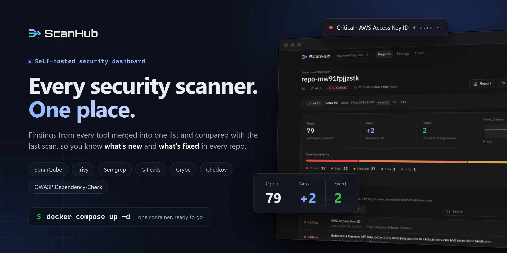
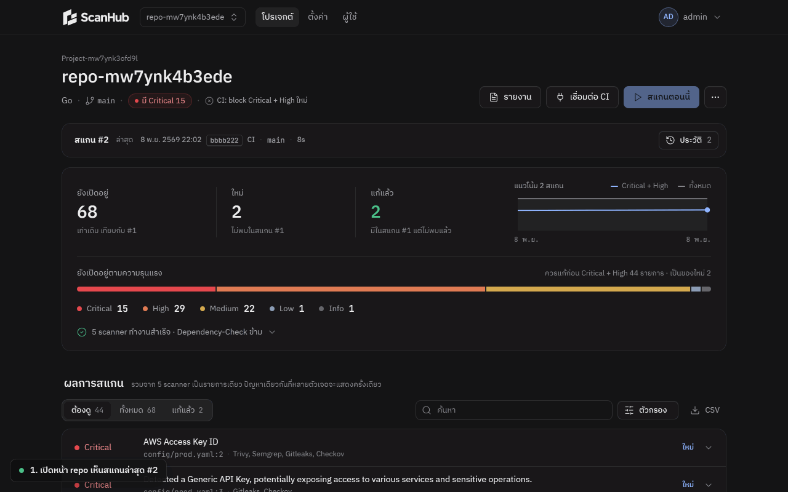
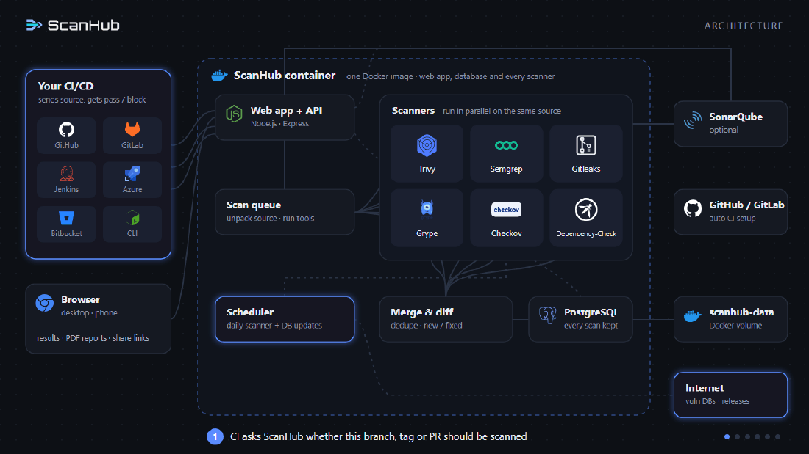
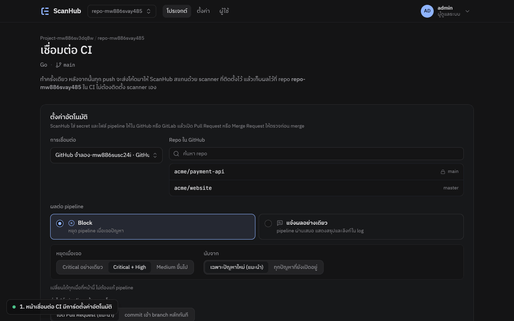
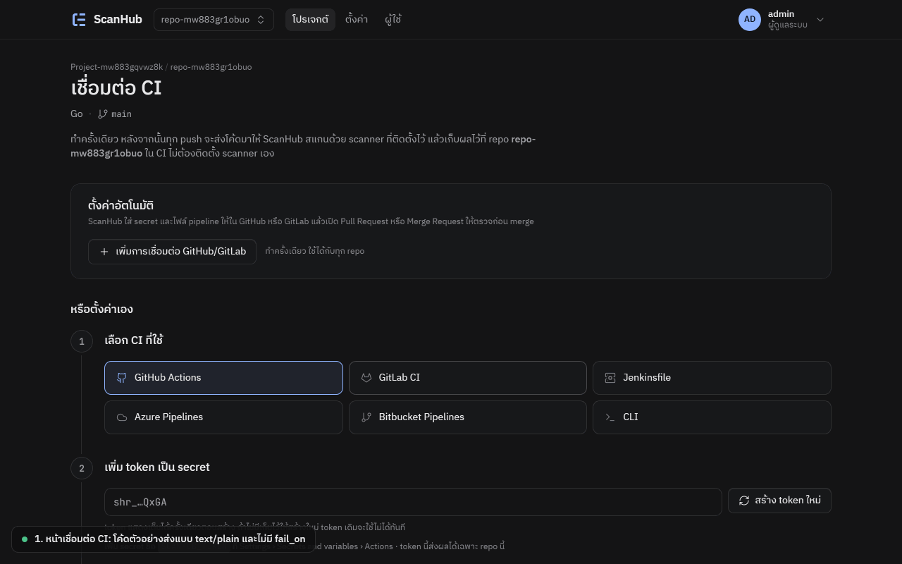
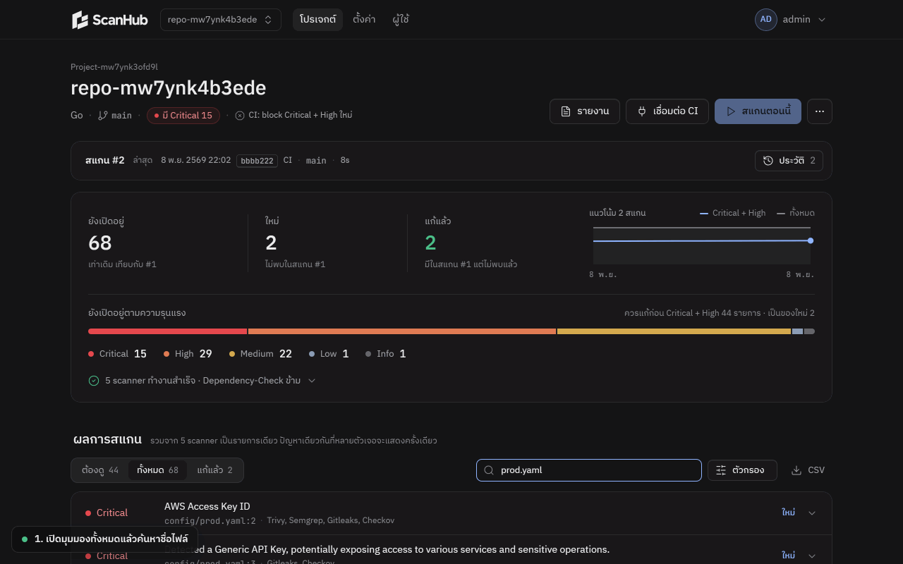
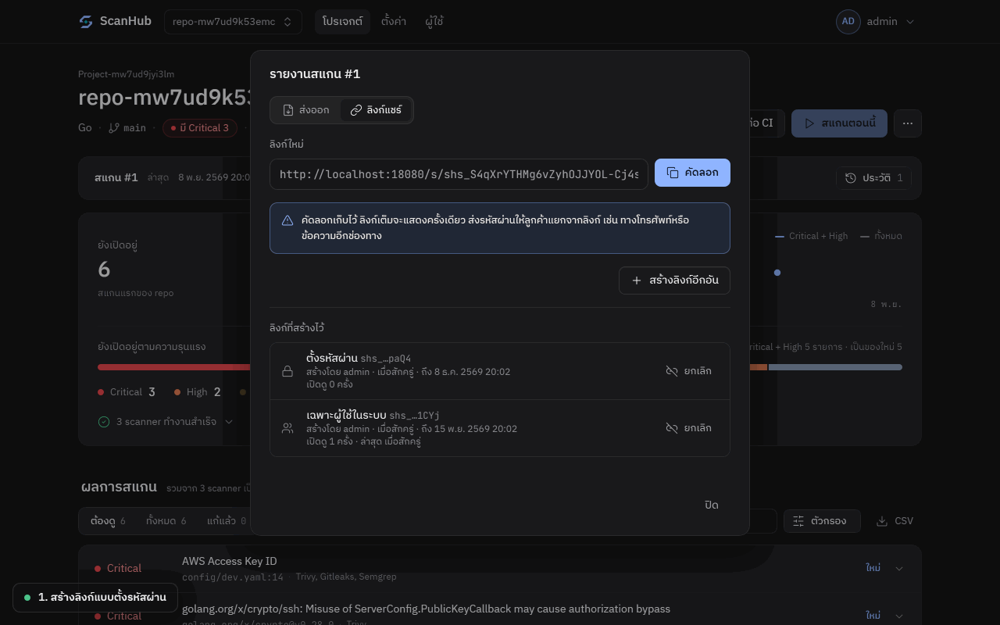
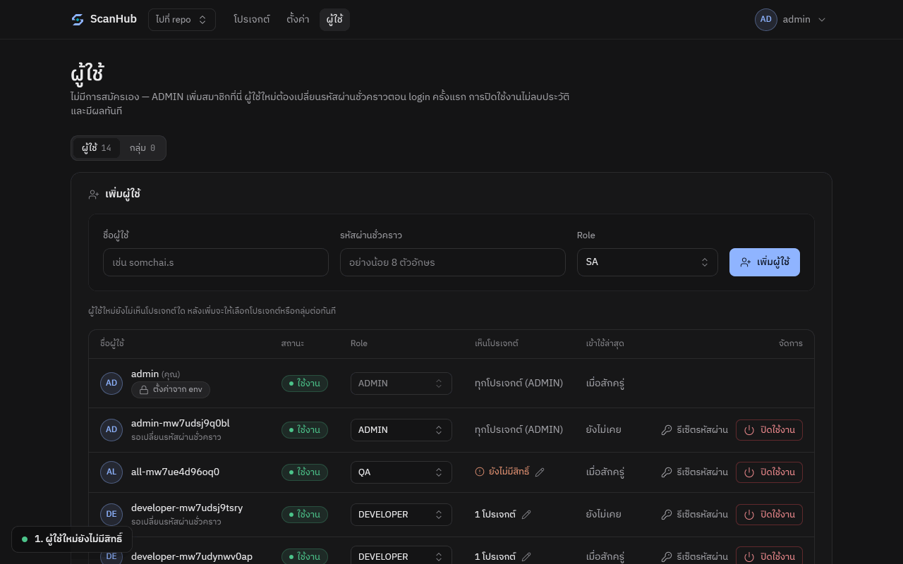
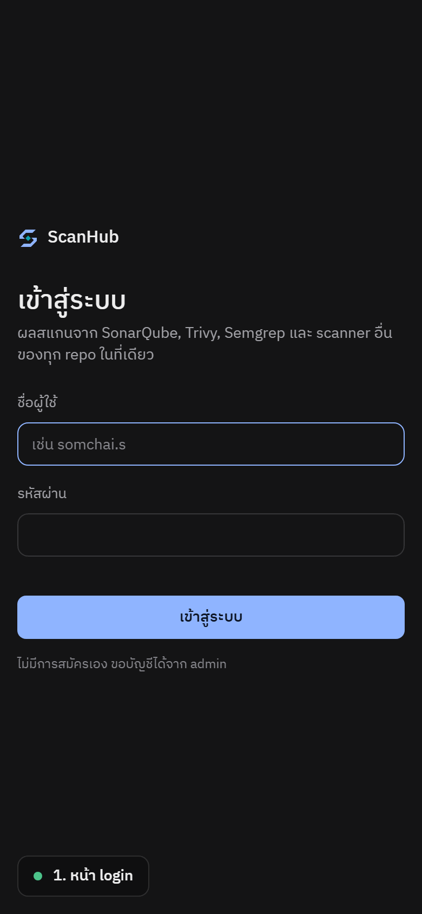

# ScanHub

ScanHub collects results from SonarQube, Trivy, Semgrep, Gitleaks, Grype, Checkov and OWASP Dependency-Check in one place, organized by project › repo. Every scan is kept in history, findings from all tools are merged into a single list, and each scan is compared with the previous one so you can see what is new and what has been fixed.



- **One-file install**: edit `docker-compose.yml` and run `docker compose up -d`. A single container holds the web app, PostgreSQL and every scanner.
- **One-click CI setup**: for GitHub / GitLab, ScanHub sets the secret and opens a Pull Request for you. For Jenkins, Azure, Bitbucket and CLI, copy a ready-made snippet.
- **Block the pipeline or just report**, and change it later without touching the pipeline.
- **Client-ready reports** as PDF / HTML, plus share links for signed-in users only or protected by a password.
- **Users, groups and per-project access**: the admin account comes from config and is re-applied on every start.
- **Scanners update themselves daily** while the system is running.

## Architecture



CI only sends source code. ScanHub runs the scanners itself, merges the findings, compares them with the right earlier scan and answers the pipeline with pass or block. See [docs/ARCHITECTURE.md](docs/ARCHITECTURE.md) for the full design and API.

---

## 1. Install

You only need Docker. Everything comes from a single `docker-compose.yml`; no cloning or building required.

| System | Docker | Notes |
| --- | --- | --- |
| Windows 10 / 11 | [Docker Desktop](https://docs.docker.com/desktop/setup/install/windows-install/) (WSL 2) | Intel / AMD and ARM |
| macOS | [Docker Desktop](https://docs.docker.com/desktop/setup/install/mac-install/) | Intel and Apple Silicon (M1 and later) |
| Linux server | Docker Engine + Compose plugin | x86_64 and arm64 |

**Requirements.** About 4 GB of free RAM for the default install (ScanHub with its scanners ~1.5–2 GB, SonarQube capped at 2 GB, its PostgreSQL 256 MB) and 10 GB+ of disk. An 8 GB host that runs other apps is enough. Without SonarQube (see below) ScanHub alone needs about 2 GB.

**SonarQube needs one host setting** (its Elasticsearch refuses to start without it). On Linux run once:

```sh
sudo sysctl -w vm.max_map_count=262144
echo vm.max_map_count=262144 | sudo tee /etc/sysctl.d/99-sonarqube.conf   # keep it after reboot
```

Docker Desktop (Windows / macOS) usually already has a high enough value; if the `sonarqube` container keeps restarting with `max virtual memory areas vm.max_map_count [65530] is too low`, run `wsl -d docker-desktop sysctl -w vm.max_map_count=262144` on Windows.

The image is published for amd64 and arm64; Docker picks the right one. You can use ScanHub from an iPhone / iPad / Android browser, but it must be installed on one of the systems above.

1. Download `docker-compose.yml` into an empty folder.

   **macOS / Linux** (Terminal)

   ```sh
   mkdir scanhub && cd scanhub
   curl -fsSLO https://raw.githubusercontent.com/SatangBudsai/scanhub/main/docker-compose.yml
   ```

   **Windows** (PowerShell)

   ```powershell
   mkdir scanhub; cd scanhub
   Invoke-WebRequest https://raw.githubusercontent.com/SatangBudsai/scanhub/main/docker-compose.yml -OutFile docker-compose.yml
   ```

2. Open the file and edit 3 lines.

   ```yaml
   SCANHUB_ADMIN_USER: admin
   SCANHUB_ADMIN_PASSWORD: your-strong-password   # at least 8 characters
   SCANHUB_URL: https://scanhub.company.local     # URL people and CI use to reach ScanHub
   ```

3. Run `docker compose up -d` in the same folder (same command on Windows and macOS). The first run downloads an image of about 2 GB that already contains the web app, PostgreSQL and every scanner.
4. Open `SCANHUB_URL` and sign in as admin. On first sign-in you choose the scanners and the daily update time.


ScanHub refuses to start while the admin password is still the example value. All data is stored in the `scanhub-data` volume.

### SonarQube (included)

The file also starts [SonarQube Community Edition](https://www.sonarsource.com/open-source-editions/sonarqube-community-edition/) (`sonarqube:community`) with its own PostgreSQL (`sonarqube-db`). It is only reachable from ScanHub (`http://sonarqube:9000`), no port is published. You don't need to configure anything: on start ScanHub waits for SonarQube (the first start takes 1–3 minutes), replaces the default `admin`/`admin` password with a random one, creates an access token and saves both encrypted in its own database. Scans that run before SonarQube is ready skip SonarQube with a note. This is repeated safely on every start and never touches a `SONAR_TOKEN` you set yourself.

- **Open the SonarQube UI:** remove the `#` in front of `ports:` and `- "9000:9000"` under `sonarqube`. To log in as `admin`, set `SONAR_ADMIN_PASSWORD` (12+ characters with upper and lower case, a digit and a symbol) before the first start, or set it later and restart ScanHub: it changes the password to that value as long as it still knows the current one.
- **Use your own SonarQube server instead:** set `SONAR_URL` and `SONAR_TOKEN` and remove the two SonarQube services.
- **Don't want SonarQube:** delete the `sonarqube` and `sonarqube-db` services, the volumes `sonarqube-data`, `sonarqube-extensions`, `sonarqube-logs`, `sonarqube-db` at the bottom, and the `SONAR_URL` line; then `docker compose up -d --remove-orphans`. The SonarQube scanner then shows as not configured and is skipped.
- If the admin password was changed outside ScanHub, auto-setup stops with a message in the logs (`docker compose logs scanhub | grep sonarqube`): set `SONAR_ADMIN_PASSWORD` to the current password, or `SONAR_TOKEN`.

### Update

```sh
docker compose pull
docker compose up -d
```

Data in the `scanhub-data` volume is kept, and the database schema migrates itself on start.

Upgrading from 1.1.0 or earlier: Semgrep no longer uses the Semgrep Registry rules (`p/default`) on its own, because those rules are under the [Semgrep Rules License](https://semgrep.dev/legal/rules-license) and only you can accept it. After the update Semgrep is skipped in scans until an admin accepts the license or sets custom rules in Settings → Scanners → Semgrep rules (or sets `SEMGREP_RULES`). To pin a version, replace `:latest` in `docker-compose.yml` with a version number such as `:1.2.0`; rolling back works the same way. All versions are listed on [GitHub Packages](https://github.com/SatangBudsai/scanhub/pkgs/container/scanhub).

### Offline servers

Move the image as a file, then start as usual.

```sh
# On a machine with internet (add --platform linux/arm64 if the target server is arm64)
docker pull ghcr.io/satangbudsai/scanhub:latest
docker save -o scanhub-image.tar ghcr.io/satangbudsai/scanhub:latest
# On the target server: copy scanhub-image.tar and docker-compose.yml into the same folder
docker load -i scanhub-image.tar
docker compose up -d
```

These commands work in Windows PowerShell, macOS and Linux.

Scanners download vulnerability databases from the internet. With no internet access at all, Trivy, Grype and Dependency-Check results will not be updated.

### Optional settings

Everything lives in `docker-compose.yml`. Remove the `#` at the start of a line to enable it.

| Setting | Purpose |
| --- | --- |
| `DATABASE_URL` | Use an existing PostgreSQL. When set, the bundled PostgreSQL is not started |
| `SONAR_URL` | SonarQube server. Default `http://sonarqube:9000` (the bundled one, set up automatically when `SONAR_TOKEN` is empty) |
| `SONAR_TOKEN` | Token for your own SonarQube server; turns auto-setup off |
| `SONAR_ADMIN_PASSWORD` | Admin password ScanHub sets on the bundled SonarQube (default: random, stored encrypted). `SONAR_AUTO=0` turns auto-setup off |
| `SEMGREP_RULES`, `SEMGREP_RULES_LICENSE_ACCEPTED` | Rules for Semgrep (`--config`: a registry id such as `p/default`, a URL or a path). Registry rules need `SEMGREP_RULES_LICENSE_ACCEPTED=true`, which accepts the [Semgrep Rules License](https://semgrep.dev/legal/rules-license) |
| `NVD_API_KEY` | Speeds up OWASP Dependency-Check's first database download (free at nvd.nist.gov) |
| `GITHUB_TOKEN`, `GITHUB_API_URL` | Connect GitHub / GitHub Enterprise for automatic CI setup |
| `GITLAB_URL`, `GITLAB_TOKEN` | Connect GitLab (gitlab.com or self-hosted) for automatic CI setup |
| `TZ` | Time zone for daily jobs (default `Asia/Bangkok`) |
| `SCAN_CONCURRENCY`, `MAX_UPLOAD_MB` | Number of concurrent scans, max source size sent by CI |

Values set in this file show as "set from env" on the settings page and cannot be edited from the web UI.

---

## 2. Connect CI/CD

Open a repo and click **Connect CI**.

### Automatic setup (GitHub / GitLab)

1. Choose the connection and the target repo.
2. Choose **Block** or **Report only**.
3. Click **Set up automatically**. ScanHub will:
   - store `SCANHUB_TOKEN` as a secret
   - add the pipeline file
   - open a Pull Request / Merge Request
4. Merge it, and every push gets scanned.



The token needs these permissions:

- **GitHub**: a fine-grained PAT with read/write on Contents, Pull requests, Secrets, Variables and Workflows (classic token: `repo`, `workflow`)
- **GitLab**: scope `api` and the Maintainer role

### Block or report only

- **Block**: the pipeline fails when new findings at the chosen level appear (Critical / Critical + High / Medium and above)
- **Report only**: the pipeline always passes

Both modes print a summary and a link to the results in the CI log. The setting is stored in ScanHub, so you can change it at any time without editing the pipeline.



### Which branches, tags and Pull Requests are scanned

The pipeline ScanHub generates runs on every branch, tag and PR, and first asks ScanHub whether to scan. Configure this on each repo's **Connect CI** page; changes apply without editing the pipeline. Refs that don't match exit immediately without uploading code.

| Setting | Example | Default |
| --- | --- | --- |
| Branch | `main, develop, release/*` | the repo's default branch only |
| Tag | `v*` or `sit_v*, uat_v*` | tags are not scanned |
| Pull Request / Merge Request | on / off | on |

`*` works anywhere in a pattern. Each scan computes "new / fixed" against the appropriate earlier scan:

- **branch**: the previous scan of the same branch
- **PR**: the target branch, so "new" means what the PR introduces. This pairs well with blocking on new findings only
- **tag**: the previous tag in the same pattern, e.g. `sit_v1.2` compares with `sit_v1.1`, not `uat_v1.1`

The repo page has a branch / PR / tag picker, and history is shown per selection. Pipelines set up before this feature keep working (they scan every run). Run automatic setup again or copy the new snippet to use branch and tag filtering.

### Manual setup

Copy the snippet for GitHub Actions, GitLab CI, Jenkins, Azure Pipelines, Bitbucket or CLI and add the `SCANHUB_TOKEN` secret. CI only sends source code; ScanHub scans it with its own scanners, so nothing needs to be installed on the CI side.

```sh
# KIND = branch | tag | pr, BASE = the PR's target branch
Q="kind=$KIND&branch=$REF&base=$BASE"
case "$(curl -sS -H "Authorization: Bearer $SCANHUB_TOKEN" -H "Accept: text/plain" "$SCANHUB_URL/api/v1/check?$Q")" in skip*) exit 0;; esac
tar --exclude=.git -czf - . | curl --fail-with-body -sS -X POST -T - \
  -H "Authorization: Bearer $SCANHUB_TOKEN" -H "Content-Type: application/gzip" -H "Accept: text/plain" \
  "$SCANHUB_URL/api/v1/scan?$Q&commit=$COMMIT&wait=1"
```

If you already run scanners in CI, you can also send their JSON/SARIF output to `/api/v1/reports`.

The CI runner must be able to reach `SCANHUB_URL`. If ScanHub is on an internal network, use a runner on the same network.

---

## 3. View results

- **The same issue found by several scanners appears once**, listed with every tool that found it.
- By default only **Needs attention** is shown (new + Critical/High). Switch to **All** or **Fixed** at any time.
- **Click a severity** to filter to that level.
- **Click a finding** to see the related code, how to fix it and reference links.



Every scan is kept in history, separated by branch / PR / tag. You can switch to older scans and download CSV.


---

## 4. Reports and sharing

On a repo page, click **Report**.

### Export

Enter the client name, pick the minimum severity, choose whether to include code, then click **Save as PDF** or **Download HTML**. The output is A4 and looks the same on any screen size.


### Share links

- **Signed-in users only**: viewers must sign in and have access to the project
- **Password protected**: can be sent to outsiders. 5 wrong passwords within 15 minutes locks the link temporarily

You can set an expiry date, revoke a link at any time and see how many times it was opened.



---

## 5. Users, groups and access

There is no self sign-up. An admin adds users on the **Users** page, and new users must change their temporary password on first sign-in.

| | ADMIN | MAINTAINER | ANALYST | VIEWER |
| --- | --- | --- | --- | --- |
| View scan results | ✓ | ✓ | ✓ | ✓ |
| Trigger scans, create share links | ✓ | ✓ | ✓ | |
| Manage projects / repos / tokens / CI | ✓ | ✓ | | |
| View settings | ✓ | ✓ | | |
| Change settings, scanners, users | ✓ | | | |

**Project visibility:** ADMIN sees every project. Other users can see a project in 3 ways:

- **See all projects** is turned on for them
- a direct grant on that project
- membership in a **group** that has access

The creator of a project sees it automatically. The project's ⋯ menu has **Who can see this project** for checking.



---

## 6. Scanners and updates

Every scanner ships with the image. Turn them on or off on the **Settings** page.

Every day at the configured time (default 03:00) ScanHub downloads the latest scanner versions and vulnerability databases while it keeps running. No rebuild is needed.

- If an update fails, the previous version stays in use and the failure is logged.
- You can roll back to the version bundled with the image.


The container needs outbound internet access (GitHub, PyPI, SonarSource, NVD). The first scan takes 3–4 minutes longer than usual while Trivy and Grype download their vulnerability databases.

ScanHub itself is updated with `docker compose pull` then `docker compose up -d`. Existing data is kept and the database migrates automatically.

---

## 7. Mobile friendly

Every page adapts to the screen size: the top menu collapses into one button and tables become cards.



---

## Licenses

ScanHub is licensed under the [Apache License 2.0](LICENSE). Every bundled scanner and runtime component keeps its own license: see [THIRD_PARTY_NOTICES.md](THIRD_PARTY_NOTICES.md) (also in the image at `/app/THIRD_PARTY_NOTICES.md`) or Settings → About and licenses in the app. The default `docker-compose.yml` also pulls the official, unmodified `sonarqube:community` image (SonarQube Community Edition, [LGPL-3.0](https://spdx.org/licenses/LGPL-3.0.html), by SonarSource) and `postgres:16-alpine` ([PostgreSQL License](https://www.postgresql.org/about/licence/)) as separate containers; they are not part of the ScanHub image. Semgrep Registry rules are under the [Semgrep Rules License](https://semgrep.dev/legal/rules-license) and are used only after you accept it. Product names and logos belong to their owners; ScanHub is not affiliated with or endorsed by them.

---

## For developers

```sh
npm install
npm test          # 45 unit + API tests (uses a temporary PostgreSQL in Docker)
npm run e2e       # 37 Playwright E2E tests, each records a GIF
npm run e2e:report

# Build the image from local code instead of pulling (E2E uses this image)
docker compose -f docker-compose.yml -f docker-compose.build.yml up -d --build
```

Every push and Pull Request runs the tests in GitHub Actions (`.github/workflows/image.yml`). Pushes to `main` build amd64 and arm64 images and publish them as `ghcr.io/satangbudsai/scanhub:latest`; a `v1.2.3` tag produces the `:1.2.3` image. The app version lives only in `package.json`.

E2E results are in `e2e/results/index.html`, with the steps, pass/fail status and a GIF for each test. Every image in this README comes from a real E2E run.

| Folder | |
| --- | --- |
| `server/` | Node.js 22 + Express + PostgreSQL |
| `public/` | the web app (`index.html`) and report page (`report.html`) |
| `docker/` | entrypoint and scanner install script |
| `test/`, `e2e/` | test suites |
| `docs/ARCHITECTURE.md` | full system design and API |
| `designs/` | the 4 UI prototypes used to choose the design |
| `docs/media/src/` | sources of the banner and architecture GIF (`node docs/media/src/build-banner.mjs`, `node docs/media/src/build-architecture.mjs`) |

Design guidance based on [unslop](https://github.com/heydamir/unslop) by Damir Sokolovsky, CC BY 4.0
